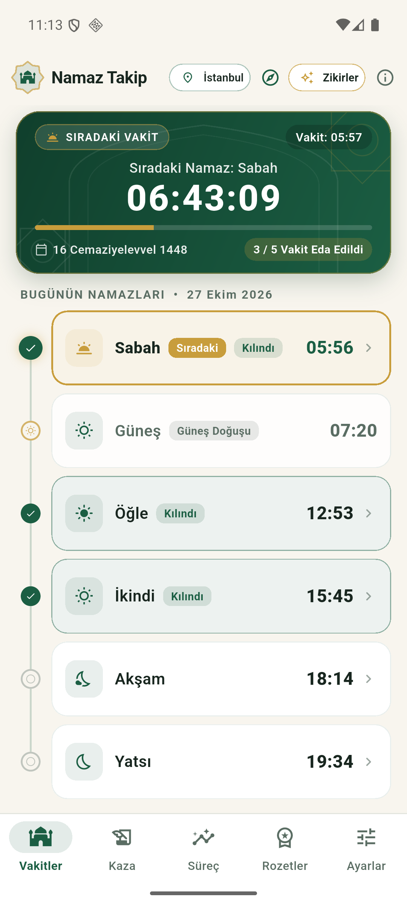
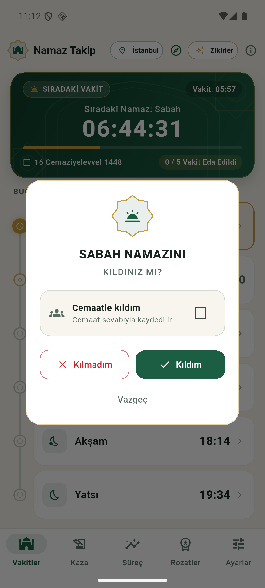
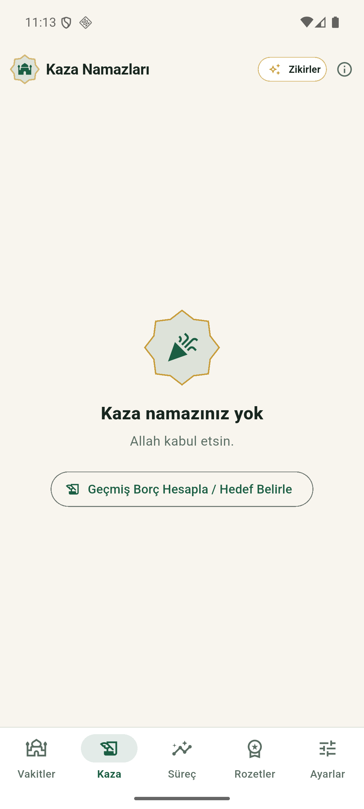
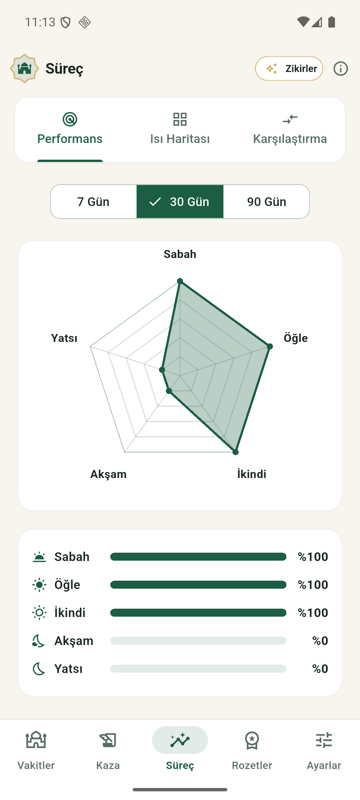
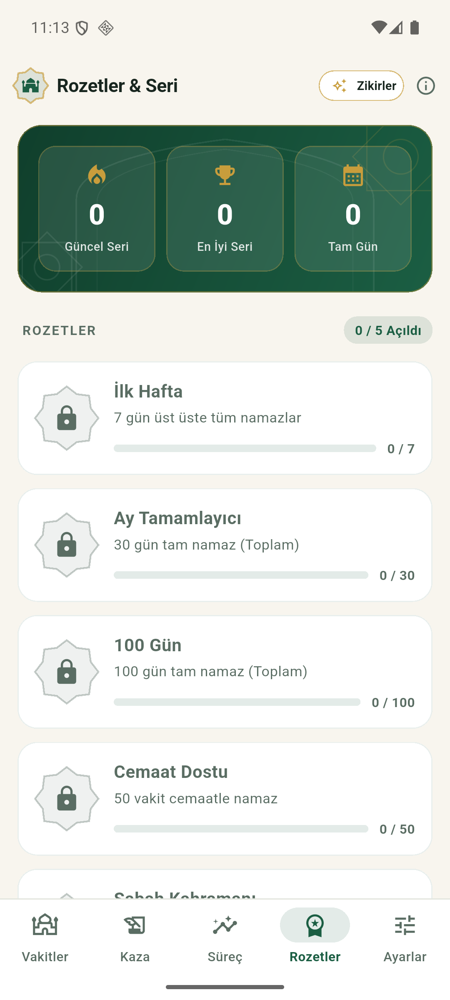
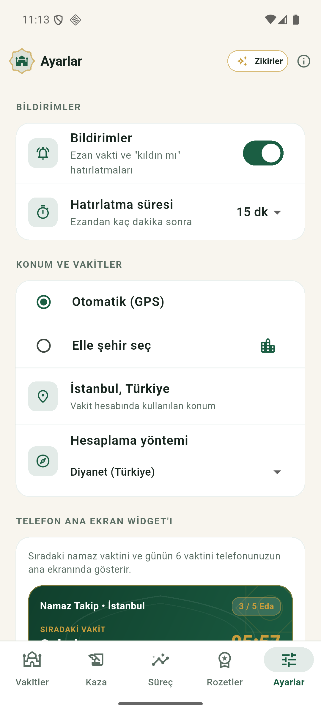
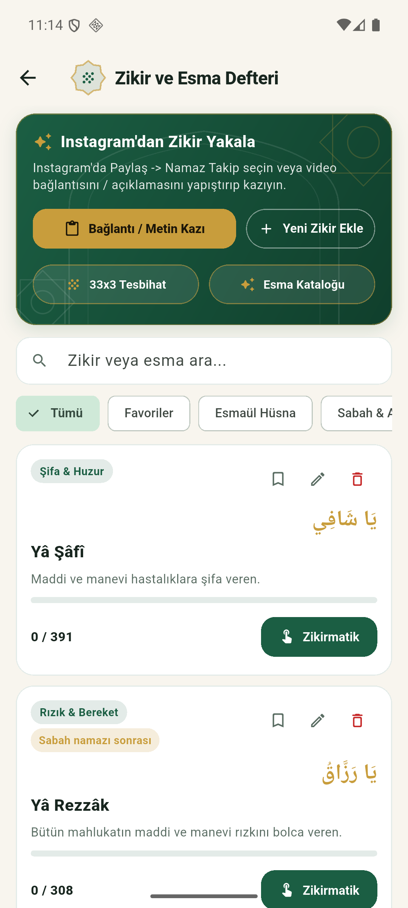
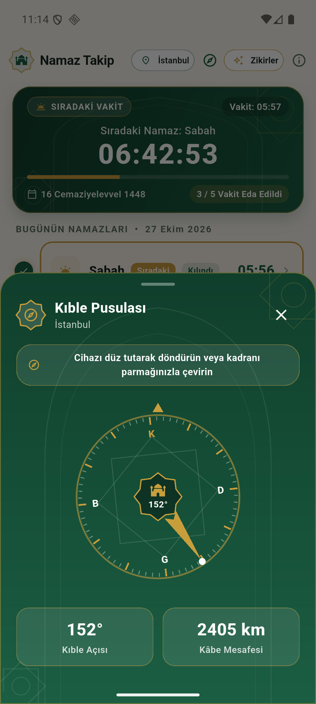
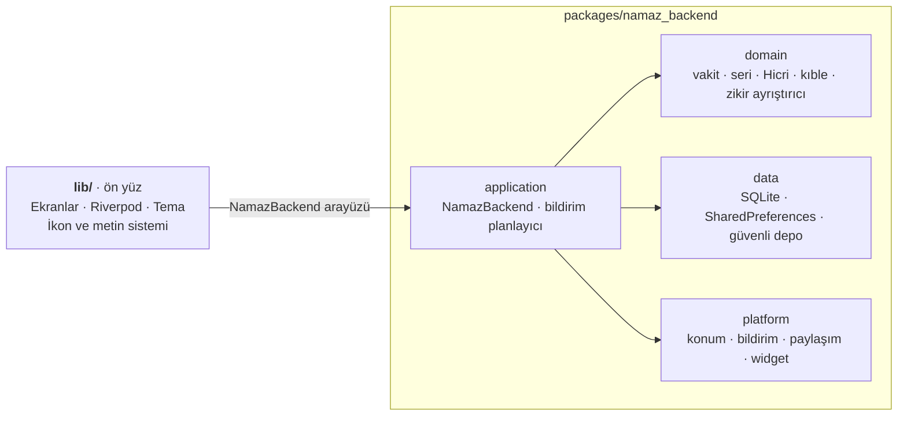

<div align="center">


# Namaz Takip

**Namazlarınızı takip edin, kazalarınızı unutmayın, zikrinizi yanınızda taşıyın.**

Vakitleri cihazınızda hesaplayan, kılınmayan namazları kendiliğinden kaza listesine alan ve sosyal medyada karşılaştığınız zikirleri tek dokunuşla deftere ekleyen, internetsiz çalışan bir namaz arkadaşı.


[Özellikler](#özellikler) · [Ekran görüntüleri](#ekran-görüntüleri) · [Gizlilik](#gizlilik-ve-güvenlik) · [Kurulum](#kurulum-ve-çalıştırma) · [Mimari](#mimari) · [Durum](#proje-durumu)

</div>

---

## Neden Namaz Takip?

- **İnternetsiz ve hızlı.** Vakitler konumunuza göre cihazda hesaplanır; sunucuya, hesaba ya da üyeliğe ihtiyaç yoktur.
- **Hiçbir namaz kaybolmaz.** İşaretlemediğiniz günler kaza listenize otomatik düşer. Kaza namazlarını vakit vakit, sizin hızınızda kapatırsınız.
- **Zikir defteri cebinizde.** Instagram, TikTok ya da YouTube Shorts'ta gördüğünüz bir zikri **Paylaş → Namaz Takip** ile yakalar; Arapça metin, okunuş, hedef sayı ve vakit önerisi taslağa kendiliğinden dolar.
- **Verileriniz sizde kalır.** Kayıtlar yalnızca telefonunuzdadır; bulut yedeği kapalıdır.

## Ekran görüntüleri

<table>
  <tr>
    <td align="center"><br><sub><b>Vakitler</b><br>Sıradaki vakit, geri sayım, Hicri tarih</sub></td>
    <td align="center"><br><sub><b>Namaz işaretleme</b><br>Kıldım, cemaatle, kılmadım</sub></td>
    <td align="center"><br><sub><b>Kaza</b><br>Otomatik liste, geçmiş borç hedefi</sub></td>
    <td align="center"><br><sub><b>Süreç</b><br>Performans radarı, ısı haritası</sub></td>
  </tr>
  <tr>
    <td align="center"><br><sub><b>Rozetler ve seri</b><br>Güncel seri, 5 rozet</sub></td>
    <td align="center"><br><sub><b>Ayarlar</b><br>Bildirim, konum, yöntem, widget</sub></td>
    <td align="center"><br><sub><b>Zikir ve Esma Defteri</b><br>Paylaşım yakalayıcı, zikirmatik</sub></td>
    <td align="center"><br><sub><b>Kıble pusulası</b><br>Açı ve Kâbe mesafesi</sub></td>
  </tr>
</table>

<sub>Görüntüler Android emülatöründe alındı (İstanbul konumu, Diyanet yöntemi, varsayılan tema).</sub>

## Özellikler

### Vakitler ve takip

- Konuma göre beş vakit ile güneş vakti; sıradaki vakte canlı geri sayım ve Hicri tarih.
- Altı hesaplama yöntemi: **Diyanet (varsayılan)**, Müslüman Dünya Birliği, Mısır, Karaçi, Ümmü'l-Kurâ ve Kuzey Amerika.
- Otomatik konum (GPS) ya da 81 il arasından elle şehir seçimi.
- Güneş doğuşunda kerahat sınırına karşı 90 saniyelik ihtiyat payı.
- Vakte dokunup **kıldım (tek başına / cemaatle)** ya da **kılmadım** diye işaretleme; kıldıktan sonra vakte uygun tesbihat önerisi.
- Gün sınırı gece yarısı değil, **en geç 04:00**'tür (yazın sabah vakti daha erken girerse o vakit): gece 00:30'da kıldığınız yatsı hâlâ dünün namazı olarak kaydedilir.

### Kaza namazları

- İşaretlenmeyen geçmiş günler kaza listesine kendiliğinden düşer; vakit vakit kaza edilir.
- Uygulamayı kurmadan önceki yıllardan kalan borcu yıl/ay/gün olarak hesaplayabilir ya da vakit sayılarını doğrudan girebilirsiniz; günlük hedefinize göre tahmini bitiş tarihi gösterilir.

### Süreç, seri ve rozetler

- Vakit bazlı **performans radarı** (7 / 30 / 90 gün), aylık **ısı haritası**, haftalık ve aylık karşılaştırma.
- Güncel seri, en iyi seri ve tam gün sayısı; beş rozet: *İlk Hafta*, *Ay Tamamlayıcı*, *100 Gün*, *Cemaat Dostu*, *Sabah Kahramanı*.

### Bildirimler

- Ezan vaktinde "önceki namazı kıldınız mı?" sorusu, ezandan sonra ayarladığınız sürede hatırlatma.
- Bildirime dokunmak doğrudan ilgili vaktin işaretleme penceresini açar.
- Telefon yeniden başlasa da, uygulama bir süre açılmasa da bildirimler arka planda yenilenir.

### Zikir ve Esma Defteri

- **Zikir yakalayıcı:** Başka uygulamadan **Paylaş → Namaz Takip** ya da bağlantı/açıklama yapıştırma. Zikir adı, Arapça metin, okunuş, anlam, hedef sayı (`100 defa`, `308 kere`, `41 kez`) ve önerilen vakit ayıklanır. İsteğe bağlı Gemini desteğiyle daha zengin sonuç alınır.
  <br><sub>Not: Instagram, giriş yapmamış istemcilere video açıklamasını vermez. Bu durumda uygulama sizi uyarır; açıklamayı kopyalayıp yapıştırmanız yeterlidir.</sub>
- Gruplama (Esmaül Hüsna, Sabah & Akşam, Rızık & Bereket, Şifa & Huzur, Namaz Tesbihatı, özel gruplar), arama, favori, düzenleme.
- Titreşimli **Zikirmatik**, hazır **33x3 namaz tesbihatı** ve **99 Esmaül Hüsna kataloğu**.

### Araçlar ve kişiselleştirme

- **Kıble pusulası:** Manyetik sapma düzeltmeli gerçek kuzey, Kıble açısı ve Kâbe'ye mesafe; sensörü olmayan cihazda açıkça uyarır.
- **Hicri takvim:** Diyanet ay başı tablosuna göre tarih, kandil ve bayram günleri.
- **Android ana ekran widget'ı:** Sıradaki vakit ve günün saatleri; uygulama açılmasa da vakit geçince kendiliğinden güncellenir.
- **Beş İslami sanat teması:** Selçuklu Zümrüdü, Gece Kubbesi, İznik Çinisi, Bordo & Gül, Tezhip Altını.

## Gizlilik ve güvenlik

Dini inanç bilgisi hassas veridir; uygulama buna göre tasarlandı.

| Konu | Nasıl ele alınıyor |
|---|---|
| Namaz kayıtları | Yalnızca cihazdaki SQLite veritabanında durur. Android bulut yedeği ve cihazdan cihaza aktarım kapalıdır. |
| Konum | Vakit hesabı cihazda yapılır; konum bilgisi bir sunucuya gönderilmez. Şehir adı, cihazın kendi geocoder servisinden alınır (Google hizmetleri yoksa koordinat gösterilir). |
| Hesap / reklam / izleme | Yoktur. |
| Bağlantı kazıma | Yalnızca `https` ve genel internet adreslerine yapılır. Yerel ağ, loopback ve bulut metadata adresleri engellenir; yönlendirmeler her adımda yeniden denetlenir. |
| Paylaşım onayı | Başka bir uygulamadan gelen içerik **otomatik işlenmez**; kazıma yalnızca siz düğmeye basınca başlar. |
| Gemini API anahtarı | İsteğe bağlıdır; Android Keystore / iOS Keychain'de saklanır. Anahtar girerseniz paylaşılan metin Google'a gönderilir, girmezseniz yerleşik sözlük çalışır. |
| Sürüm imzası | Release derlemesi imza anahtarı olmadan bilerek durur; yanlışlıkla debug imzalı sürüm üretilmez. |

Ayrıntılı denetim kaydı: [`docs/wiki/guvenlik-ve-kalite-analizi.md`](docs/wiki/guvenlik-ve-kalite-analizi.md).

## Kurulum ve çalıştırma

> Uygulama henüz mağazada yayınlanmadı; şimdilik kaynaktan derlenir.

**Gereksinimler:** Flutter SDK 3.47 (Dart 3.13) veya üzeri, Android SDK. Windows kurulum adımları: [`docs/wiki/gelistirme-ortami.md`](docs/wiki/gelistirme-ortami.md).

```bash
git clone https://github.com/Yusufygc/NamazTakipApp.git
cd NamazTakipApp
flutter pub get
flutter run
```

Cihaza kurulabilir APK üretmek için:

```bash
flutter build apk --debug                                  # debug APK
ALLOW_DEBUG_SIGNING=1 flutter build apk --release          # yan yükleme testi (mağazaya yüklenemez)
```

PowerShell'de ikinci komut için: `$env:ALLOW_DEBUG_SIGNING = "1"; flutter build apk --release`.

Mağaza sürümü için `android/key.properties` ile gerçek imza anahtarı gerekir; adımlar [`derleme-ve-yayin.md`](docs/wiki/derleme-ve-yayin.md) sayfasındadır.

**Test ve analiz:**

```bash
flutter analyze
flutter test                                  # ön yüz
cd packages/namaz_backend && flutter test     # backend
cd android && ./gradlew :app:testDebugUnitTest   # Kotlin (widget ve pusula mantığı)
```

## Mimari

Uygulama iki pakettir: **ön yüz** yalnızca görünümü ve metni bilir, **backend** iş kurallarını ve platform erişimini taşır. Aralarındaki tek köprü `NamazBackend` arayüzüdür; sınır, iki `architecture_test.dart` ile otomatik denetlenir.



### Teknoloji

| Katman | Seçim |
|---|---|
| Çatı | Flutter 3.47, Dart 3.13, Material 3 |
| Durum yönetimi | Riverpod 3 |
| Vakit hesabı | `adhan_dart` (cihazda, internetsiz) |
| Veri | `sqflite` (SQLite) ve `shared_preferences` |
| Gizli veri | `flutter_secure_storage` (Keystore / Keychain) |
| Konum | `geolocator`, `geocoding` |
| Bildirim ve arka plan | `flutter_local_notifications`, `timezone`, `workmanager` |
| Grafik | `fl_chart` |
| Yerel kod | Kotlin (widget, pusula, paylaşım), Swift (iOS köprüsü, widget, paylaşım uzantısı) |

### Tasarım kararları

- **Vakitler cihazda hesaplanır.** Sunucu yok, kota yok, çevrimdışı çalışır. Aladhan ile karşılaştırmada Diyanet yöntemi ≤ 2 dakika fark verdi.
- **Kaza listesi türetilir.** Ayrı bir kaza tablosu yoktur; işaretlenmemiş geçmiş vakitlerden hesaplanır, bu yüzden tutarsız kalamaz.
- **Tarihler `yyyy-MM-dd` metni.** `ORDER BY` ve `BETWEEN` doğrudan çalışır, saat dilimi kayması olmaz.
- **Sabit bildirim kimlikleri.** Kimlik tarih ve vakitten türetilir; yeniden planlama çift bildirim üretmez, üzerine yazar.
- **Bozuk veritabanı kurtarma.** Dosya silinmeden önce yedeklenir ve kullanıcı uyarılır.
- **Merkezi ikon ve metin sistemi.** Ekranlarda emoji, `Icons.xxx` ya da sabit Türkçe metin bulunmaz; `test/central_system_test.dart` bunu denetler.

### Proje yapısı

```
lib/                    ön yüz: ekranlar, sağlayıcılar, tema, ikon ve metin sistemi
packages/namaz_backend/ backend: domain · data · platform · application
android/, ios/          platform projeleri ve yerel köprüler
test/                   ön yüz testleri
tool/                   emülatör başlatma betiği
docs/wiki/              proje bilgi tabanı (mimari, kararlar, test notları)
docs/screenshots/       README görselleri
```

## Proje durumu

| | |
|---|---|
| Sürüm | 1.0.0 (henüz yayınlanmadı) |
| Kalite | `flutter analyze` temiz; 185 test geçiyor (ön yüz 46, backend 124, Kotlin 15) |
| Doğrulanan | Android emülatörü (bildirim, konum, widget, paylaşım, pusula) |
| Doğrulanmayan | Gerçek telefonda pil kısıtlamaları ve bildirim güvenilirliği; iOS derlemesi (Mac gerekir); dört ek temanın görsel testi |
| Dini içerik | Esmaül Hüsna, zikir ve kerahat metinleri iç tutarlılık açısından test edildi; **dini uzman onayı bekliyor**: [`dini-icerik-onayi.md`](docs/wiki/dini-icerik-onayi.md) |
| Hicri takvim | Diyanet tablosu 7 Mayıs 2027'ye kadar; sonrası algoritmik tahmindir |

Açık işlerin tamamı: [`bilinen-sorunlar.md`](docs/wiki/bilinen-sorunlar.md) ve [`yol-haritasi.md`](docs/wiki/yol-haritasi.md).

## Belgeler

Proje bilgisi `docs/wiki/` altında birbirine bağlı sayfalarda tutulur; başlangıç noktası [`docs/wiki/index.md`](docs/wiki/index.md).

| Konu | Sayfa |
|---|---|
| Genel bakış | [`proje-ozeti.md`](docs/wiki/proje-ozeti.md) |
| Mimari | [`mimari-genel.md`](docs/wiki/mimari-genel.md), [`backend-paketi.md`](docs/wiki/backend-paketi.md) |
| Veri | [`veri-katmani.md`](docs/wiki/veri-katmani.md) |
| Bildirimler | [`bildirimler.md`](docs/wiki/bildirimler.md), [`izinler.md`](docs/wiki/izinler.md) |
| Zikir paylaşımı | [`zikir-paylasim.md`](docs/wiki/zikir-paylasim.md) |
| Test | [`test-stratejisi.md`](docs/wiki/test-stratejisi.md) |
| Kararlar | [`kararlar.md`](docs/wiki/kararlar.md) |

## Katkı

Hata bildirimi ve öneriler için bir *issue* açabilirsiniz. Kod katkısından önce şu kurallara göz atın:

1. İş kuralı backend'e, görünüm ve metin ön yüze yazılır; `packages/namaz_backend/lib/src/` ön yüzden içe aktarılmaz.
2. İkonlar `lib/core/icons/app_icons.dart`, metinler `lib/core/strings/` altındadır; ekranlara sabit metin yazılmaz.
3. Değişiklikten sonra `flutter analyze` temiz olmalı, iki pakette `flutter test` geçmelidir.
4. Kullanıcıya görünen metinler Türkçedir; kod yorumları ve commit mesajları tam cümlelerle yazılır.

---

<div align="center">

MYY tarafından geliştirildi · [GitHub: Yusufygc](https://github.com/Yusufygc/NamazTakipApp) · Namazlarınız kabul olsun.

</div>
